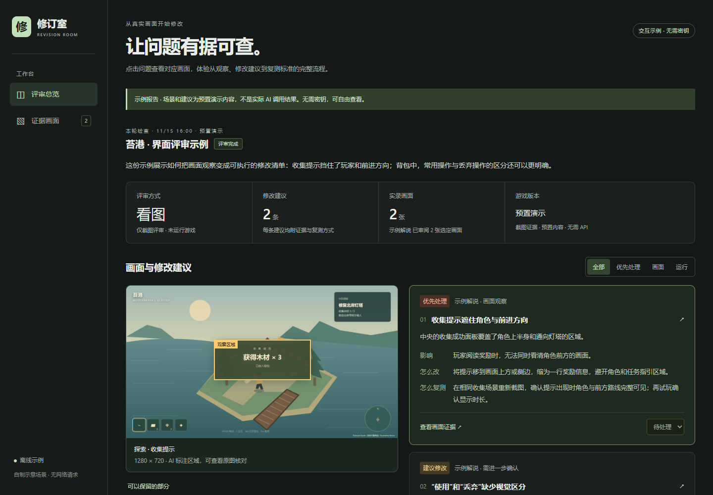

# Revision Room · 修订室

**Turn game screenshots into an evidence-backed revision list.**

An AI review desk for game developers: see the problem area, understand its impact, choose a concrete change, and know what to check afterward. Bring your own vision model, or use your local Codex login.

[简体中文](README.zh-CN.md) · [Quick start](#quick-start) · [Providers](docs/providers.md) · [Contributing](CONTRIBUTING.md)



*The preview uses an original illustrative scene and a clearly labeled, curated report. It is not a live AI result. The current application interface and review output are in Simplified Chinese.*

## Download and run

[Download the Windows x64 portable app](https://github.com/QAQ-cmyk/revision-room/releases/download/v0.2.0/revision-room-0.2.0-windows-x64.zip). Extract the entire ZIP, then open **打开修订室.cmd**. With Microsoft Edge installed, select **网页试玩 → 苔港 → 开始网页试玩** to run a five-step example. Every step saves a screenshot. Use **载入路线复测** in the report to repeat the same route after a change.

[Interactive sample report](https://qaq-cmyk.github.io/revision-room/) · [Bring a local browser game](docs/web-routes.md) · [Community discussions](https://github.com/QAQ-cmyk/revision-room/discussions)

## Try it before connecting an AI

Download the project ZIP and open **[docs/index.html](docs/index.html)** in a browser. This self-contained interactive demo works offline, needs no Python or API key, and makes no API calls. Select a finding, inspect its image, filter the list, and open the full screenshot.

To review your own game, start the local app below. The same demo is available through **先看示例报告**.

## What you get

- **An annotated image for each visual finding.** Check the exact evidence before accepting a suggestion.
- **A practical revision list.** Observation → impact → suggested change → verification criteria, with priority and confidence.
- **Your choice of vision model.** Codex login, Grok, Gemini, Claude, Qwen, OpenAI API, or a compatible endpoint.
- **A local review history.** Track open / planned / ready-to-retest findings and export Markdown plus an evidence ZIP.
- **Honest failure states.** Missing or invalid AI output is shown as incomplete; captured evidence remains available.

## Ways to collect evidence

| Mode | Works with | What happens |
| --- | --- | --- |
| Screenshot review | Any game with PNG, JPG, or WebP screenshots | Import 1–10 images; the browser makes PNG review copies up to 1600 px on the longest side. The chosen AI reviews them. |
| Browser route | A loopback-hosted HTML game | Run a keyboard and click sequence, check text and visibility, export step-by-step screenshots and replay the route. |
| Automated playtest | Instrumented Windows builds of **StarTide / 星潮漂流** | Runs the existing opening, systems, and save-reload checks, captures images, and optionally requests visual review. |

**Screenshot review does not launch the game.** Automated play requires a game-specific integration; dropping an arbitrary executable into the app will not make it playable by an agent. Static images cannot establish input latency, audio quality, animation continuity, performance, or long-term fun.

## Quick start

Supported setup: **Windows 10/11, Python 3.11 or newer, and a modern browser**. When running from source, install the optional browser driver with `py -3 -m pip install -r requirements-web.txt`. Screenshot review uses the Python standard library. The portable ZIP includes Python and the browser driver.

1. Download and extract the project.
2. Double-click **打开修订室.cmd**, or run:

   ```powershell
   py -3 launch.py
   ```

3. In **管理 AI 接口**, enter your provider's base URL, vision model name, and API key. Use **测试看图** to send one small test image, then **保存并选用**. Alternatively, select Codex if its CLI is installed and logged in locally.
4. Choose **导入游戏截图**, add a few representative images, optionally describe the player goal, and select **评审这些画面**.

The desk opens at `http://127.0.0.1:4185`. For another port, run `py -3 server.py --port 4186 --open`. Closing the browser leaves the local service running. The **停止检查** button stops the current review.

## Models, accounts, and data

The app implements OpenAI-compatible Chat Completions and native Claude Messages. Model names are entered explicitly, so you can use the vision models available in your own account. Provider presets do not guarantee every model or account is compatible. See [setup details and official documentation](docs/providers.md).

API keys are encrypted with Windows DPAPI under `%LOCALAPPDATA%\RevisionRoom\ai_profiles.json`. They are not stored in the repository, browser storage, reports, or exported bundles. This protects the saved file; programs running as the same Windows user can still use that user's credentials.

Selected screenshots, their labels, your supplied context, and relevant check summaries are sent to the AI service you choose. Codex uses its existing local login; other services use their own API credentials and billing. A web subscription is not an API key. Requests are not retried automatically. Stopping locally cannot retract a request already accepted by a provider.

The desk listens only on the local loopback interface. Evidence and history live in `runs/`, which is ignored by Git. Reports may still include game content and local build paths—inspect exports before sharing them.

## Development

```powershell
py -3 -m unittest discover -s tests -p "test_*.py" -v
py -3 tools/build_demo.py
```

The tests use temporary directories and a local mock AI server; they do not contact paid providers or run a real game. For the optional isolated browser fixture, run `py -3 tests/serve_fixture.py` and open port 4181. Its mock endpoint on port 4182 is for development only.

| File | Responsibility |
| --- | --- |
| `server.py` | Local HTTP app, guarded operations, evidence downloads |
| `engine.py` | Evidence, review jobs, Codex integration, StarTide checks |
| `providers.py` | Encrypted profiles and vision API transports |
| `web/` | Dependency-free interface and original demo scenes |
| `review_schema.json` | Shared contract for evidence-linked findings |
| `docs/index.html` | Generated offline demo; also ready for GitHub Pages |

The Windows test workflow is included. GitHub Pages can serve `docs/` on the default branch; enable it in your repository's Pages settings when you want a public demo. No account setup or deployment is performed by this project automatically.

## Next useful contributions

- English interface and selectable report language.
- Compare the same screenshots across models or before/after revisions.
- Documented adapters for other games and engines.
- Secure credential storage for macOS and Linux.

These are planned directions, not shipped features. See [contribution guidance](CONTRIBUTING.md) and [current validation](docs/validation.md). A useful contribution can be a reproducible visual issue or a clearer verification criterion, not only code.

If this helps your next game revision, a **star** is a useful way to follow the project. Actual game examples and feedback are especially welcome.

## License

[MIT](LICENSE). The included **Moss Harbor / 苔港** scenes are original illustrative fixtures. No private game builds, player saves, AI credentials, or historical review screenshots are included.
