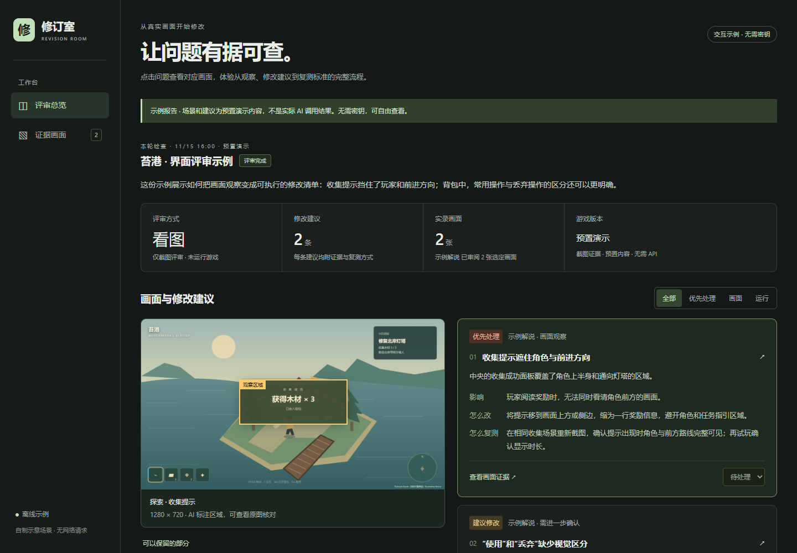

# Revision Room · 修订室

**把游戏截图，变成有依据、能执行、可复测的修改清单。**

给独立游戏开发者用的 AI 评审工作台。先看问题出在哪里，再决定怎么改。支持自己的视觉模型接口，也能使用本机已登录的 Codex。

[English](README.md) · [接口配置](docs/providers.md) · [参与开发](CONTRIBUTING.md)



*上图使用自制「苔港」示意场景与预置解说，明确标为示例，不是 AI 实时结果。*

## 下载 Windows 便携版

[下载 Windows 64 位便携包](https://github.com/QAQ-cmyk/revision-room/releases/download/v0.2.0/revision-room-0.2.0-windows-x64.zip)。完整解压后双击 **打开修订室.cmd**。电脑需装有 Microsoft Edge。首次可直接选 **网页试玩 → 苔港 → 开始网页试玩**，实际运行五个步骤，无需 AI 密钥。完成后可下载截图和记录，修改游戏后点 **载入路线复测** 再跑一轮。

[在线体验示例报告](https://qaq-cmyk.github.io/revision-room/) · [接入自己的网页游戏](docs/web-routes.md) · [社区讨论](https://github.com/QAQ-cmyk/revision-room/discussions)

## 不用密钥，先体验

下载并解压项目，双击 **[docs/index.html](docs/index.html)**：可以离线点击问题、切换证据、查看原图和筛选建议。不需要安装 Python，也不会调用 AI。

运行完整版后，页面内同样有 **先看示例报告**。

## 它帮你做什么

- **找位置**：每条视觉建议都对应截图，并圈出观察区域，方便核对。
- **定修改**：说明看见了什么、会有什么影响、建议怎么改、改完怎么确认。
- **选模型**：Codex、Grok、Gemini、Claude、通义千问、OpenAI API，以及兼容接口。
- **留证据**：保存历史、记录待处理 / 已安排 / 待复测状态，导出 Markdown 和截图证据包。
- **保留失败现场**：AI 连接失败或返回格式不合格，会明确显示未完成，保留本轮截图。

已有看图结果时，在「导入游戏截图」中选择原图，再展开「已有这些截图的评审结果？」导入 JSON。文件遵循 [评审格式](review_schema.json)。`inspected_screenshots` 和每条建议的 `screenshot_id` 填写原图文件名（含扩展名）；`region` 使用整图的百分比坐标。工具会按文件名核对并关联图片，保存到本机历史。此入口不调用模型。

## 收集证据

| 方式 | 适用范围 | 做的事情 |
| --- | --- | --- |
| 导入游戏截图 | 任何游戏的 PNG、JPG、WebP 截图 | 最多 10 张，浏览器生成长边不超过 1600 像素的 PNG 副本，交给所选 AI 评审。 |
| 网页试玩 | 本机运行的 HTML 游戏 | 执行键盘与点击操作，检查文字及窗口可见性，逐步截图，保存路线复测。 |
| 自动试玩 | 接入了检查入口的《星潮漂流》Windows 版本 | 自动开场、系统检查、两次存档复查，保存截图，再进行视觉评审。 |

截图模式不会运行游戏。任意 EXE 还不能直接自动试玩，需要先适配操作与取证流程。静态截图无法证明操作手感、音效、动画、性能或长期可玩性。

## 开始使用

从源码运行需要 **Windows 10/11、Python 3.11 或更新版本、现代浏览器**。网页试玩另需 Microsoft Edge，并执行 `py -3 -m pip install -r requirements-web.txt` 安装浏览器驱动。便携包已附 Python 和驱动。

1. 下载并解压项目，双击 **打开修订室.cmd**。也可以在项目目录执行：

   ```powershell
   py -3 launch.py
   ```

2. 点 **管理 AI 接口**，填写服务商基础地址、视觉模型名称和 API 密钥。先 **测试看图**，再 **保存并选用**。已安装并登录 Codex CLI 的用户，也可以直接选择 Codex。
3. 选 **导入游戏截图**，放入几个有代表性的画面。可以补一句玩家目标或检查重点，不必先自己找问题。
4. 点 **评审这些画面**。完成后核对标注、查看建议、导出清单。修改后重新评审，状态标记本身不代表修复成功。

本地地址是 `http://127.0.0.1:4185`。端口被占用时，可以执行 `py -3 server.py --port 4186 --open`。关闭浏览器不会停止本地服务；中断当前任务请用页面的 **停止检查**。

## 接口与隐私

支持 OpenAI 兼容 Chat Completions 和 Claude 原生 Messages。模型名从你自己的服务商控制台复制，需选择能看图的模型。具体设置见 [接口指南](docs/providers.md)。

API 密钥由当前 Windows 用户加密，保存在 `%LOCALAPPDATA%\RevisionRoom\ai_profiles.json`；不会写入仓库、浏览器存储或导出报告。同一 Windows 用户权限下运行的程序仍能访问该用户的凭据。

正式评审会发送所选截图、图片说明、你填写的背景和相关检查摘要。Codex 使用本机登录；其他接口使用各自的 API 账户和计费，网页订阅不能直接当 API 密钥。程序不会自动重试；已经提交的请求可能继续由服务商处理。

服务只监听本机。历史保存在 `runs/`，默认不进入 Git。导出的证据包可能包含游戏内容和本地版本路径，分享前请核对。

## 开发与贡献

```powershell
py -3 -m unittest discover -s tests -p "test_*.py" -v
py -3 tools/build_demo.py
```

测试使用临时目录和本地模拟接口，不调用付费模型，不运行真实游戏。已附 Windows 自动测试工作流。`docs/index.html` 也可作为 GitHub Pages 演示页：发布仓库后，在 Pages 设置中选择默认分支的 `/docs` 目录即可。

希望继续改进：英文界面、修改前后对照、多模型对比、更多游戏适配，以及其他系统的安全密钥存储。这些仍是后续方向，当前版本没有宣称已经支持。

欢迎提交可复现的问题、界面建议或游戏适配。参见 [贡献指南](CONTRIBUTING.md)、[验证记录](docs/validation.md)。如果它对你的游戏迭代有帮助，可以点个 **Star** 关注进展。

## 许可

[MIT](LICENSE)。示例场景为自制内容；发布包不包含私有游戏、玩家存档、密钥和个人历史截图。
